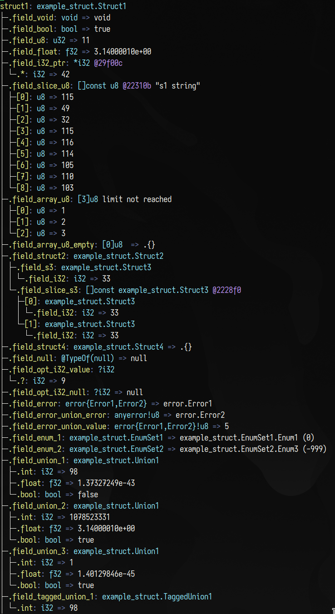

# Tree Formattar for Zig
- Pretty prints out Zig Values for your debugging needs.
- If you faces any issue with formatting, kindly open an issue.

## Versioning
- Current `main` branch tracks zig latest version (currently Zig `0.17.0`)
- If you need a stable version, see release tags

## Objective
- Provide a colored tree-like visual representation of a Zig value to aid in debugging.

## Features
- Colored output to distinguish between types and values
- Indentation to show the structure of the value
- Special formatters for following types (Do file a PR or FR if you think there are more types that can require special formatting)
  - `std.MultiArrayList`
  - `std.HashMapUnmanaged`

## Screenshot


## Example
- You can run one of the examples in the `examples` by executing the following command:
```bash
zig build test -Dtest-filter="anon struct 1"
```
- You might need to remove `.zig-cache` to run it again without changes.

## Usage
- Zig Package Manager Example: https://github.com/speed2exe/tree-fmt-example
- `build.zig.zon`
```zon
.{
    .name = "your_package_name",
    .version = "0.0.1",
    .dependencies = .{
        .tree_fmt = .{
            .url = "https://github.com/speed2exe/tree-fmt/archive/0.17.0.tar.gz",
            // just do `zig build`, get the error and replace with expected hash
            .hash = "...",
        },
    },
    .paths = .{ "" },
}
```
> **Tip:** You can also run `zig fetch --save https://github.com/speed2exe/tree-fmt/archive/0.17.0.tar.gz` to auto-populate the hash.
- `build.zig`
```zig
pub fn build(b: *std.Build) void {
    // ...
    const dep = b.dependency("tree_fmt", .{});
    const tree_fmt = dep.module("tree-fmt");
    your_program.root_module.addImport("tree-fmt", tree_fmt);
}
```

### Quick Setup
- Fastest and easiest way to if you want to save time and effort.
- This example is in `example_default_tree_formatter.zig`

```zig
var tree_formatter = @import("tree-fmt").defaultFormatter();

pub fn main() !void {
    const my_struct = .{ 1, 2.4, "hi" };
    try tree_formatter.format(my_struct, .{
        .name = "my_struct", // (optional) just an identifier to the root of the tree
    });
}
```
- Output:
```
my_struct: struct { comptime comptime_int = 1, comptime comptime_float = 2.4, comptime *const [2:0]u8 = "hi" }
├─.0: comptime_int => 1
├─.1: comptime_float => 2.4
└─.2: *const [2:0]u8 @1024b3675
  └─.*: [2:0]u8 "hi"
    ├─[0]: u8 => 104
    └─[1]: u8 => 105
```


### Proper Setup
- This is recommended, as it gives you more control over writer, allocator and settings.

```zig
const std = @import("std");

// add imports here
const treeFormatter = @import("tree-fmt").treeFormatter;

pub fn main(init: std.process.Init) !void {
    const allocator = init.gpa;

    // any writer implementing print(fmt, args) and writeAll(bytes) works
    // here we use std.debug.print via a simple wrapper
    const DebugWriter = struct {
        pub fn print(self: @This(), comptime fmt: []const u8, args: anytype) !void {
            _ = self;
            std.debug.print(fmt, args);
        }
        pub fn writeAll(self: @This(), bytes: []const u8) !void {
            _ = self;
            std.debug.print("{s}", .{bytes});
        }
    };
    const w = DebugWriter{};

    // initialize TreeFormatter with allocator and writer
    var tree_formatter = treeFormatter(allocator, w);

    // initialize your value
    const sentinel_array: [*:0]const u8 = "hello world";

    // call the method with value
    try tree_formatter.format(sentinel_array, .{
        // .name = "sentinel_array", <-- example setting
        // you can find settings at @import("./src/tree-fmt.zig").TreeFormatterSettings;
        // you can also leave it blank to use default settings
    });
}
```

- Output:
```
.: [*:0]const u8 @1029959ab "hello world"
├─[0]: u8 => 104
├─[1]: u8 => 101
├─[2]: u8 => 108
├─[3]: u8 => 108
├─[4]: u8 => 111
└─... (showed first 5 out of 11 items only)
```

- You can find other examples in the `examples` directory. To run specific example(s):
```bash
    zig build test -Dtest-filter="name of test"
    # e.g. zig build test -Dtest-filter="anon struct 1"
```

## Example
- `std.ArrayList(u8)` (`zig build test -Dtest-filter="array list"`)
```
.: array_list.Aligned(u8,null)
├─.items: []u8 @104a84010
│ ├─[0]: u8 => 0
│ ├─[1]: u8 => 1
│ ├─[2]: u8 => 2
│ ├─[3]: u8 => 3
│ ├─[4]: u8 => 4
│ └─... (showed first 5 out of 100 items only)
├─.capacity: usize => 129
└─.pointer_stability: debug.SafetyLock
  └─.state: debug.SafetyLock.State__enum_32 => .unlocked (0)
```

- `std.AutoHashMap(u8, u8)` (`zig build test -Dtest-filter="map"`)
```
map: hash_map.HashMap(u8,u8,hash_map.AutoContext(u8),80)
├─.unmanaged: hash_map.Custom(u8,u8,hash_map.AutoContext(u8),80)
│ ├─.iterator()
│ │ ├─.next(): hash_map.Custom(u8,u8,hash_map.AutoContext(u8),80).Entry
│ │ │ ├─.key_ptr: *u8 @104f14030
│ │ │ │ └─.*: u8 => 2
│ │ │ └─.value_ptr: *u8 @104f14038
│ │ │   └─.*: u8 => 4
│ │ ├─.next(): hash_map.Custom(u8,u8,hash_map.AutoContext(u8),80).Entry
│ │ │ ├─.key_ptr: *u8 @104f14035
│ │ │ │ └─.*: u8 => 0
│ │ │ └─.value_ptr: *u8 @104f1403d
│ │ │   └─.*: u8 => 0
│ │ └─.next(): hash_map.Custom(u8,u8,hash_map.AutoContext(u8),80).Entry
│ │   ├─.key_ptr: *u8 @104f14036
│ │   │ └─.*: u8 => 1
│ │   └─.value_ptr: *u8 @104f1403e
│ │     └─.*: u8 => 2
│ ├─.metadata: ?[*]hash_map.Custom(u8,u8,hash_map.AutoContext(u8),80).Metadata
│ │ └─.?: [*]hash_map.Custom(u8,u8,hash_map.AutoContext(u8),80).Metadata @104f14028
│ ├─.size: u32 => 3
│ ├─.available: u32 => 3
│ └─.pointer_stability: debug.SafetyLock
│   └─.state: debug.SafetyLock.State__enum_32 => .unlocked (0)
├─.allocator: mem.Allocator
│ ├─.ptr: *anyopaque @104e59680
│ └─.vtable: *const mem.Allocator.VTable @104e11cb8
│   └─.*: mem.Allocator.VTable
│     ├─.alloc: *const fn (*anyopaque, usize, mem.Alignment, usize) ?[*]u8 @104d8e040
│     ├─.resize: *const fn (*anyopaque, []u8, mem.Alignment, usize, usize) bool @104d94284
│     ├─.remap: *const fn (*anyopaque, []u8, mem.Alignment, usize, usize) ?[*]u8 @104d8e70c
│     └─.free: *const fn (*anyopaque, []u8, mem.Alignment, usize) void @104d948c8
└─.ctx: hash_map.AutoContext(u8) => .{}
```

- `std.MultiArrayList(...)` (`zig build test -Dtest-filter="multi array list"`)
```
multi_array_list1: multi_array_list.MultiArrayList(examples.test.multi array list.Person)
├─.slice(): multi_array_list.MultiArrayList(examples.test.multi array list.Person).Slice
│ └─.items()
│   ├─(.id): []u64 @104398010
│   │ ├─[0]: u64 => 0
│   │ ├─[1]: u64 => 1
│   │ ├─[2]: u64 => 2
│   │ ├─[3]: u64 => 3
│   │ ├─[4]: u64 => 4
│   │ └─... (showed first 5 out of 7 items only)
│   ├─(.age): []u8 @104398120
│   │ ├─[0]: u8 => 0
│   │ ├─[1]: u8 => 1
│   │ ├─[2]: u8 => 2
│   │ ├─[3]: u8 => 3
│   │ ├─[4]: u8 => 4
│   │ └─... (showed first 5 out of 7 items only)
│   └─(.car): []examples.test.multi array list.Car @104398098
│     ├─[0]: examples.test.multi array list.Car
│     │ └─.license_plate_no: u64 => 555
│     ├─[1]: examples.test.multi array list.Car
│     │ └─.license_plate_no: u64 => 555
│     ├─[2]: examples.test.multi array list.Car
│     │ └─.license_plate_no: u64 => 555
│     ├─[3]: examples.test.multi array list.Car
│     │ └─.license_plate_no: u64 => 555
│     ├─[4]: examples.test.multi array list.Car
│     │ └─.license_plate_no: u64 => 555
│     └─... (showed first 5 out of 7 items only)
├─.get()
│ ├─(0): examples.test.multi array list.Person
│ │ ├─.id: u64 => 0
│ │ ├─.age: u8 => 0
│ │ └─.car: examples.test.multi array list.Car
│ │   └─.license_plate_no: u64 => 555
│ ├─(1): examples.test.multi array list.Person
│ │ ├─.id: u64 => 1
│ │ ├─.age: u8 => 1
│ │ └─.car: examples.test.multi array list.Car
│ │   └─.license_plate_no: u64 => 555
│ ├─(2): examples.test.multi array list.Person
│ │ ├─.id: u64 => 2
│ │ ├─.age: u8 => 2
│ │ └─.car: examples.test.multi array list.Car
│ │   └─.license_plate_no: u64 => 555
│ ├─(3): examples.test.multi array list.Person
│ │ ├─.id: u64 => 3
│ │ ├─.age: u8 => 3
│ │ └─.car: examples.test.multi array list.Car
│ │   └─.license_plate_no: u64 => 555
│ └─... (showed first 4 out of 7 items only)
├─.bytes: [*]u8 @104398010
├─.len: usize => 7
└─.capacity: usize => 17
```

- `multi_array_list.MultiArrayList(zig.Ast.TokenList).Slice` (`zig build test -Dtest-filter="zig program"`)
```
ast: multi_array_list.MultiArrayList(zig.Ast.TokenList__struct_999).Slice
├─.slice(): multi_array_list.MultiArrayList(zig.Ast.TokenList__struct_999).Slice
│ └─.items()
│   ├─(.tag): []zig.tokenizer.Token.Tag @1011bc0d8
│   │ ├─[0]: zig.tokenizer.Token.Tag => .keyword_const (82)
│   │ ├─[1]: zig.tokenizer.Token.Tag => .identifier (1)
│   │ ├─[2]: zig.tokenizer.Token.Tag => .equal (11)
│   │ ├─[3]: zig.tokenizer.Token.Tag => .builtin (6)
│   │ ├─[4]: zig.tokenizer.Token.Tag => .l_paren (15)
│   │ └─... (showed first 5 out of 31 items only)
│   └─(.start): []u32 @1011bc010
│     ├─[0]: u32 => 1
│     ├─[1]: u32 => 7
│     ├─[2]: u32 => 11
│     ├─[3]: u32 => 13
│     ├─[4]: u32 => 20
│     └─... (showed first 5 out of 31 items only)
├─.get()
│ ├─(0): zig.Ast.TokenList__struct_999
│ │ ├─.tag: zig.tokenizer.Token.Tag => .keyword_const (82)
│ │ └─.start: u32 => 1
│ ├─(1): zig.Ast.TokenList__struct_999
│ │ ├─.tag: zig.tokenizer.Token.Tag => .identifier (1)
│ │ └─.start: u32 => 7
│ ├─(2): zig.Ast.TokenList__struct_999
│ │ ├─.tag: zig.tokenizer.Token.Tag => .equal (11)
│ │ └─.start: u32 => 11
│ ├─(3): zig.Ast.TokenList__struct_999
│ │ ├─.tag: zig.tokenizer.Token.Tag => .builtin (6)
│ │ └─.start: u32 => 13
│ ├─(4): zig.Ast.TokenList__struct_999
│ │ ├─.tag: zig.tokenizer.Token.Tag => .l_paren (15)
│ │ └─.start: u32 => 20
│ └─... (showed first 5 out of 31 items only)
├─.ptrs: [2][*]u8
│ ├─[0]: [*]u8 @1011bc0d8
│ └─[1]: [*]u8 @1011bc010
├─.len: usize => 31
└─.capacity: usize => 50
```
